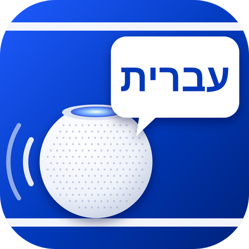

  
  

# HomePod Israel Hebrew — הכרזות קוליות בעברית בהום פוד

**ההום פוד מדבר בקול טבעי, בעברית, מתוך הבית של אפל — בלחיצה, בסירי או מאוטומציה.**

🇺🇸 [English](README.md)

כותבים משפט → הוא הופך למתג בבית של אפל → מדליקים את המתג וההום פוד מקריא אותו. אתם בוחרים איזה הום פוד ידבר (אחד, כמה או כולם ביחד), באיזה קול ובאיזה ווליום.

## מה יש בו

- 🇮🇱 **נבנה לישראלים** — עברית כברירת מחדל, מסך הגדרות בעברית (עם מעבר לאנגלית).
- 💬 **משפט = מתג** — כל משפט שכותבים הופך למתג משלו.
- 🔊 **בחירת הום פוד לכל משפט** — מטבח בלבד, חדר שינה בלבד, או שניהם ביחד.
- 🎙️ **קול + סגנון לכל משפט** — 16 קולות Gemini שונים לגמרי (מפתח חינמי), הילה ואברי של מיקרוסופט, Google ו-ElevenLabs. ו-9 סגנונות: שמח, רגוע, לחישה, כרוז, דחוף, חם, נרגש, שובב.
- ▶️ **השמעת בדיקה** מתוך מסך ההגדרות, לפני ששומרים.
- 🔍 **חיפוש הום פודים אוטומטי** — לא צריך לחפש כתובות IP.
- 🔁 **מטמון וגיבוי** — כל משפט נוצר פעם אחת ונשמר. אם שירות הקול נופל, עוברים לקול חינמי.
- 🔗 **Webhook** — הקראת כל טקסט מקיצורים באייפון.
- 🧩 **עצמאי לגמרי** — לא תלוי באף פלאגין אחר, ולא צריך להתקין שום דבר ידנית.

## עצמאות וגיבוי

- הפלאגין **מתקין ומתחזק בעצמו** את מנוע ה-AirPlay (pyatv) בסביבה פרטית משלו, עם גרסאות נעולות ובדוקות. לא צריך להריץ שום פקודה.
- **כל ההגדרות** נשמרות ב-config של Homebridge, ו**קבצי הקול** נשמרים בתיקיית Homebridge — שניהם נכללים ב**גיבוי** של Homebridge.
- אם Homebridge נמחק ומשחזרים מגיבוי — הפלאגין מותקן מחדש, ההגדרות חוזרות, ומנוע הקול נבנה מחדש לבד בהפעלה הראשונה.

---

## מדריך התקנה שלב אחר שלב

### שלב 1 — התקנה
ממשק Homebridge → **Plugins** → מחפשים **homebridge-homepod-israel-hebrew** → **Install**.

### שלב 2 — מנוע הקול
פותחים את הגדרות הפלאגין (⚙️). למעלה מופיע מצב מנוע הקול:
- **"מנוע הקול מוכן ✓"** — אפשר להמשיך.
- **"מנוע הקול לא מותקן"** — לוחצים **"התקן מנוע קול"** ומחכים כמה דקות (פעם אחת בלבד).

### שלב 3 — הוספת ההום פודים
לוחצים **"🔍 חפש הום פודים"** ואז **"הוסף"** ליד כל הום פוד. אפשר לשנות את השם ולקבוע ווליום ברירת מחדל.

> 💡 מומלץ לקבע לכל הום פוד כתובת IP קבועה בראוטר.

### שלב 4 — כתיבת משפטים
לוחצים **"➕ הוסף משפט"** ולכל משפט:
1. כותבים את **הטקסט** שיוקרא.
2. מסמנים **מי ידבר** — הום פוד אחד, כמה, או אף אחד (= כולם).
3. בוחרים **קול** (או משאירים את ברירת המחדל).
4. אפשר לסמן **ווליום מיוחד**.
5. לוחצים **"▶️ השמע עכשיו"** כדי לשמוע.

### שלב 5 — שמירה
לוחצים **Save** ומפעילים מחדש את Homebridge. המתגים מופיעים בבית של אפל.

### שלב 6 — שימוש
- לחיצה על המתג, או *"היי סירי, תדליקי כביסה מוכנה"*.
- אוטומציה בבית של אפל: למשל *"כשמכונת הכביסה מסיימת"* → הדלק את המתג **"הכביסה מוכנה"**.

---

## הקולות והסגנונות

לכל משפט בוחרים **קול** (מי מדבר) ו**סגנון** (איך הוא מדבר).

| קולות | כמה | חינם או בתשלום? |
|---|---|---|
| 🎙️ **Gemini** — Zephyr, Kore, Leda, Sulafat, Puck, Charon, Algenib ועוד | 16 קולות שונים לגמרי, 8 נשים ו-8 גברים | 🆓 **חינם** — מפתח חינמי, בלי כרטיס אשראי |
| 👩👨 **מיקרוסופט** — הילה, אברי | 2 קולות עבריים | 🆓 **חינם**, בלי מפתח |
| 👩👨 רב-לשוני — אווה, אמה, אנדרו, בריאן | 4 (ייתכן מבטא) | 🆓 **חינם**, בלי מפתח |
| 👩👨 **Cartesia** — קולות עבריים מלידה | לפי הספרייה שלהם | 🆓 **חינם עד מכסה** — 20,000 תווים בחודש, בלי כרטיס אשראי |
| 🎤 **הקול שלך** — שיבוט קול | ההום פוד מדבר בקול שלך | 💳 **בתשלום** — מנוי ElevenLabs שכולל Voice Cloning |
| 👩👨 **OpenAI** — Coral, Nova, Onyx, Ash ועוד | 13 קולות | 💳 **בתשלום** — לפי שימוש, צריך כרטיס אשראי |
| ⭐ ElevenLabs | כל קול מהספרייה | 💳 **בתשלום** (יש מכסה חינמית קטנה) |
| 👩👨 Google Chirp 3 HD | 12 | 💳 **דורש חשבון חיוב** ב-Google Cloud (יש מכסה חינמית חודשית) |

> 💡 **לא חייבים לשלם כלום.** Gemini, מיקרוסופט ו-Cartesia (במכסה החינמית) מספיקים לגמרי. הקולות בתשלום הם תוספת למי שרוצה.
> כל משפט נוצר **פעם אחת** ונשמר במטמון — השמעה חוזרת של אותו משפט לא צורכת מכסה.

**סגנונות:** רגיל · שמח ועליז · רגוע ושקט · לחישה · כרוז רשמי · דחוף / אזהרה · חם ואוהב · נרגש · שובב.
קולות Gemini **באמת מבצעים** את הסגנון (לוחשים, מתלהבים, מכריזים). בקולות של מיקרוסופט הסגנון הוא שינוי מהירות וגובה בלבד — ולכן לגיוון אמיתי מומלץ Gemini.

### Gemini — מפתח חינמי (🆓 2 דקות)
1. נכנסים ל-[aistudio.google.com/apikey](https://aistudio.google.com/apikey) עם חשבון Google.
2. אם מופיע חלון **Import projects** — אין צורך לשנות כלום, סוגרים אותו ב-✕.
3. לוחצים **Create API key**, בוחרים פרויקט (כל אחד מהם, למשל Default Gemini Project) ולוחצים **Copy**.
   המפתח מתחיל ב-`AQ.` (הפורמט החדש של Google) או ב-`AIza` (הפורמט הישן) — שניהם עובדים.
   🔒 המפתח אישי: לא שולחים אותו לאף אחד ולא מפרסמים אותו. אם נחשף — מוחקים אותו ב-AI Studio ויוצרים חדש.
4. בהגדרות הפלאגין מדביקים בתיבה הצהובה "רוצה הרבה קולות שונים באמת?" ובוחרים קול Gemini.

### 🎤 שיבוט קול — ההום פוד מדבר בקול שלך (💳 בתשלום)
1. מגדירים מפתח ElevenLabs (ראו למטה). שיבוט קול דורש מנוי ElevenLabs שכולל Voice Cloning.
2. מקליטים 1–2 דקות של דיבור ברור בעברית בחדר שקט — למשל באפליקציית **תזכורות קוליות** — ושומרים לקבצים.
3. בהגדרות הפלאגין → **"שיבוט קול"** → נותנים שם, בוחרים את הקובץ ולוחצים **"צור קול"**.
4. הקול מופיע בקבוצה **"הקולות המשובטים שלך"** בכל משפט.

> שבטו רק את הקול שלכם, או של מי שהסכים לכך.

### Cartesia — קולות עבריים מלידה (חינם עד 20,000 תווים בחודש)
1. נכנסים ל-[play.cartesia.ai](https://play.cartesia.ai) ונרשמים (אפשר עם חשבון Google).
2. במסך **"How did you hear about us?"** לוחצים **Skip** (למטה משמאל).
3. במסך הבחירה לוחצים **Start with Models** (הכרטיס העליון). את **Agents** לא צריך.
4. בתפריט (☰) או ב-**Settings** נכנסים ל-**API Keys** → **New / Create API Key** → נותנים שם, למשל `homebridge`.
5. מעתיקים את המפתח **מיד** — הוא מוצג פעם אחת בלבד. הוא מתחיל ב-`sk_car_`.
6. בהגדרות הפלאגין → **"קולות פרימיום"** → מדביקים בתיבה של Cartesia → לוחצים **"טען קולות עבריים"**.
7. לוחצים **"הוסף"** ליד הקולות שאהבתם → **שמירה**. הם יופיעו ברשימת הקולות של כל משפט, ואפשר לבדוק כל אחד עם ▶️.

> בקולות Cartesia הסגנון משפיע על המהירות בלבד. 🔒 את המפתח מדביקים רק בהגדרות הפלאגין — לא שולחים אותו לאף אחד.

### OpenAI — הרבה קולות שמבצעים סגנון (💳 בתשלום)
1. ב-[platform.openai.com/api-keys](https://platform.openai.com/api-keys) יוצרים מפתח (מתחיל ב-`sk-`), ומוסיפים אמצעי תשלום.
2. מדביקים ב-**"קולות פרימיום"** ובוחרים קול OpenAI. ייתכן מבטא קל בעברית.

### ElevenLabs — הקול הכי טבעי (💳 בתשלום)
1. נרשמים ב-[elevenlabs.io](https://elevenlabs.io) → פרופיל → **API Keys** → יוצרים מפתח.
2. בוחרים קול ב-**Voice Library**, מוסיפים לקולות שלך ומעתיקים את ה-**Voice ID**.
3. בהגדרות הפלאגין → **"קולות פרימיום"** → מדביקים מפתח ו-Voice ID → בוחרים בקול **"ElevenLabs"**.

### Google Chirp 3 HD — הכי ברור (💳 דורש חשבון חיוב)
1. ב-[Google Cloud Console](https://console.cloud.google.com) יוצרים פרויקט ומפעילים **Cloud Text-to-Speech API**.
2. **APIs & Services → Credentials → Create API key** (מומלץ להגביל ל-Text-to-Speech).
3. בהגדרות הפלאגין → **"קולות פרימיום"** → מדביקים את המפתח → בוחרים קול Google.

---

## Webhook — כל טקסט מקיצורים באייפון

מפעילים ב-**"Webhook"** בהגדרות, וקובעים פורט (ברירת מחדל `8095`) וטוקן.

| בקשה | מה היא עושה |
|---|---|
| `GET /say?text=שלום&speakers=מטבח,חדר שינה הורים&voice=avri&volume=50&token=…` | הקראת כל טקסט |
| `POST /say` עם JSON `{"text":"…","speakers":"מטבח"}` | אותו דבר, לטקסט ארוך |
| `GET /announce?name=הכביסה מוכנה&token=…` | השמעת משפט מוגדר |
| `GET /status?token=…` | מצב, הום פודים ומשפטים |

**קיצור לדוגמה:** פעולה **טקסט** → פעולה **קבלת תוכן של URL** עם הכתובת `http://<IP של Homebridge>:8095/say`, שיטה **POST**, גוף **JSON**: `text` = הטקסט, `token` = הטוקן.

---

## פתרון תקלות

- **"מנוע הקול לא מותקן" ולא מצליח להתקין** — הריצו פעם אחת בטרמינל: `sudo apt install -y python3-venv` ואז לחצו שוב "התקן מנוע קול".
- **"HomePod not found on the network"** — ודאו שה-IP נכון ושההום פוד ו-Homebridge באותה רשת.
- **שגיאת הרשאה** — בבית של אפל → הגדרות הבית → *גישה לרמקולים ולטלוויזיות* → *כל מי שנמצא באותה רשת*.
- **מילה נשמעת לא נכון** — כתבו בכתיב מלא או עם ניקוד חלקי, או נסו קול אחר.
- **מכשירים שמסומנים "דורש צימוד"** (טלוויזיות, Apple TV) — לא נתמכים, רק הום פוד ורמקולי AirPlay פתוחים.

## תמיכה

אם הפלאגין עוזר לכם — אפשר [לקנות לי קפה ☕](https://paypal.me/orenasher). תקלות ורעיונות: [GitHub](https://github.com/orenasher/homebridge-homepod-israel-hebrew/issues).

