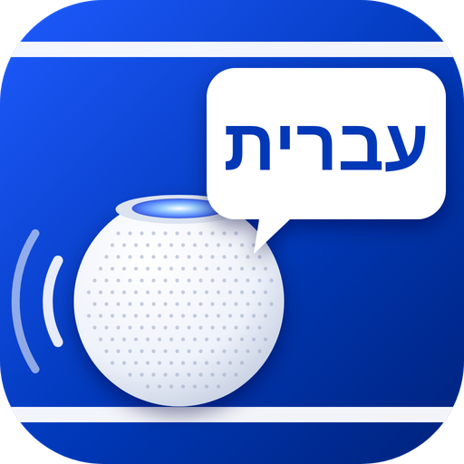

<p align="center"></p>

<p align="center">
  <a href="https://www.npmjs.com/package/homebridge-homepod-israel-hebrew"></a>
  <a href="https://paypal.me/orenasher"></a>
</p>

# HomePod Israel Hebrew

**Natural-voice spoken announcements on your HomePods — from Apple Home switches, Siri and automations. Built for Hebrew, works in English too.**

🇮🇱 [מדריך בעברית](README.he.md) (default language of the plugin)

Type a sentence → it becomes a switch in Apple Home → turn it on and the HomePod says it. For every sentence you choose which HomePod speaks (one, several or all together), which voice and what volume.

## Highlights

- 🇮🇱 **Made for Israelis** — Hebrew by default, bilingual settings screen (Hebrew / English toggle).
- 💬 **One phrase = one switch.**
- 🔊 **Pick the HomePods per phrase** — kitchen only, bedroom only, or both together.
- 🎙️ **Voice + style per phrase** — 16 truly different Gemini voices (free key), Microsoft's Hila & Avri, Google and ElevenLabs; 9 styles: cheerful, calm, whisper, announcer, urgent, warm, excited, playful.
- ▶️ **Test playback** right from the settings screen.
- 🔍 **Automatic HomePod discovery** — no IP hunting.
- 🔁 **Cache & fallback** — each phrase is generated once; if a voice service fails it falls back to a free voice.
- 🔗 **Webhook** — say any text from iPhone Shortcuts.
- 🧩 **Fully self-contained** — no other plugins, nothing to install by hand.

## Independence & backup

- The plugin **installs and maintains its own AirPlay engine** (pyatv) in a private environment with pinned, known-good versions. No commands to run.
- **Settings** live in the Homebridge config and **audio files** in the Homebridge storage folder — both are part of the Homebridge **backup**.
- Restore Homebridge from a backup and everything comes back; the voice engine rebuilds itself on first start.

---

## Step-by-step setup

1. **Install** — Homebridge UI → **Plugins** → search **homebridge-homepod-israel-hebrew** → **Install**.
2. **Voice engine** — open the plugin settings (⚙️). If the badge says *"Voice engine not installed"*, tap **Install voice engine** and wait a few minutes (one time).
3. **Add HomePods** — tap **🔍 Find HomePods**, then **Add** next to each. Rename them and set a default volume if you like. Tip: give each HomePod a fixed IP in your router.
4. **Write phrases** — tap **➕ Add phrase**. Type the text, tick **who speaks** (none ticked = all), pick a voice, optionally a custom volume, and tap **▶️ Play now** to hear it.
5. **Save** and restart Homebridge. The switches appear in Apple Home.
6. **Use it** — tap the switch, ask Siri, or trigger it from an Apple Home automation.

---

## Voices & styles

Every phrase has a **voice** (who speaks) and a **style** (how they speak).

| Voices | How many | Cost |
|---|---|---|
| 🎙️ **Gemini** — Zephyr, Kore, Leda, Sulafat, Puck, Charon, Algenib… | 16 truly different voices, 8 female / 8 male | **Free key** (no credit card) |
| 🎤 **Your own voice** — voice cloning | The HomePod speaks in your voice | ElevenLabs key with Voice Cloning |
| 👩👨 **Cartesia** — native Hebrew voices | from their library | Cartesia key |
| 👩👨 **OpenAI** — Coral, Nova, Onyx, Ash… | 13 voices | OpenAI key (pay-as-you-go) |
| 👩👨 **Microsoft** — Hila, Avri | 2 native Hebrew voices | Free, no key |
| 👩👨 Multilingual — Ava, Emma, Andrew, Brian | 4 (may have an accent) | Free |
| 👩👨 Google Chirp 3 HD | 12 | Google Cloud key |
| ⭐ ElevenLabs | any voice from the library | ElevenLabs key |

**Styles:** normal · cheerful · calm · whisper · announcer · urgent · warm · excited · playful.
Gemini voices really *perform* the style; for Microsoft voices a style is only a speed/pitch change — so for real variety use Gemini.

**Gemini (free, 2 minutes):** open [aistudio.google.com/apikey](https://aistudio.google.com/apikey) (if an *Import projects* window opens, just close it) → **Create API key** → pick any project → **Copy** → paste it in the yellow box in the settings → pick a Gemini voice.
The key starts with `AQ.` (Google's new format) or `AIza` (old format) — both work. 🔒 Keep it private; if it was exposed, delete it in AI Studio and create a new one.

**🎤 Voice cloning:** set an ElevenLabs key (a plan with Voice Cloning is required) → record 1–2 minutes of clear speech (e.g. Voice Memos) → settings → **Voice cloning** → name it, pick the file, **Create voice**. Only clone your own voice or someone who agreed.

**Cartesia:** [play.cartesia.ai](https://play.cartesia.ai) → **API Keys** → paste under **Premium voices** → **Load Hebrew voices** → **Add** the ones you like.

**OpenAI:** [platform.openai.com/api-keys](https://platform.openai.com/api-keys) → paste under **Premium voices** → pick an OpenAI voice (may have a slight accent in Hebrew).

**ElevenLabs:** [elevenlabs.io](https://elevenlabs.io) → **API Keys**; copy a **Voice ID** from the Voice Library; paste both under **Premium voices**.

**Google Chirp 3 HD:** enable **Cloud Text-to-Speech API** in [Google Cloud Console](https://console.cloud.google.com), create an API key, paste it under **Premium voices**.

---

## Webhook — say any text from iPhone Shortcuts

Enable **Webhook** in the settings (default port `8095`) and set a token.

| Request | What it does |
|---|---|
| `GET /say?text=Hello&speakers=Kitchen,Bedroom&voice=avri&volume=50&token=…` | Say any text |
| `POST /say` with JSON `{"text":"…","speakers":"Kitchen"}` | Same, for long text |
| `GET /announce?name=Laundry done&token=…` | Play a configured phrase |
| `GET /status?token=…` | State, HomePods and phrases |

Shortcut: *Text* → *Get Contents of URL* `http://<homebridge-ip>:8095/say`, Method **POST**, Request Body **JSON** with `text` and `token`.

---

## Config example (for reference — the settings screen writes this for you)

```json
{
  "platform": "HomePodIsraelHebrew",
  "name": "HomePod Israel Hebrew",
  "language": "he",
  "voice": "hila",
  "speakers": [
    { "name": "Kitchen", "host": "192.168.1.50", "id": "AA:BB:CC:DD:EE:FF", "volume": 50 },
    { "name": "Bedroom", "host": "192.168.1.51", "id": "11:22:33:44:55:66" }
  ],
  "phrases": [
    { "text": "The laundry is done", "speakers": ["Kitchen"], "voice": "avri-deep", "volume": 60 },
    { "text": "Good night everyone", "name": "Good night", "speakers": ["Kitchen", "Bedroom"] },
    { "text": "Dinner is ready" }
  ],
  "webhook": { "enabled": true, "port": 8095, "token": "change-me" }
}
```

## Troubleshooting

- **Voice engine can't install** — run once in the terminal: `sudo apt install -y python3-venv`, then tap *Install voice engine* again.
- **"HomePod not found on the network"** — check the IP and that Homebridge and the HomePod are on the same network.
- **Permission error** — Home app → Home Settings → *Allow Speaker & TV Access* → *Everyone on the same network*.
- **Devices marked "needs pairing"** (TVs, Apple TV) are not supported — HomePods and open AirPlay speakers only.

## Support

If this plugin helps you, [buy me a coffee ☕](https://paypal.me/orenasher). Issues and ideas: [GitHub](https://github.com/orenasher/homebridge-homepod-israel-hebrew/issues).

MIT © Oren Asher
